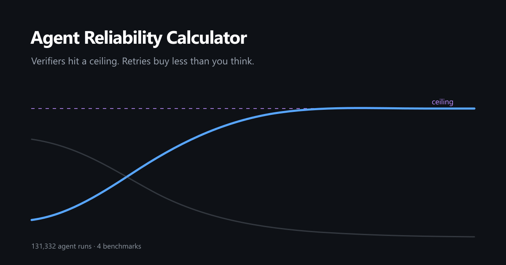

# 📉 Agent Reliability Calculator

[](https://doi.org/10.6084/m9.figshare.34509963)

An interactive calculator for engineers who plan AI agent pipelines: it shows why adding verifiers hits a ceiling, and why retries buy far less than `1−(1−p)^k` suggests.
Every default is calibrated on **131,332 real agent runs** across four public benchmarks.

**▶ Live demo: https://anaexplores.github.io/agent-reliability-calculator/**



AI agent reliability is usually estimated with two formulas: `p^N` for a chain of steps and `pass@k = 1−(1−p)^k` for retries. Both assume independence. In practice, retries of the same agent on the same task are strongly correlated (median ICC 0.49–0.67 across our corpora), and all verifiers share a blind spot: errors none of them can see. The blind spot, not verifier strength, sets the ceiling. This calculator makes both effects visible and prices them.

Open `index.html`: no build step, no backend, nothing you load leaves the browser.

## Four blocks

1. **The reliability ceiling of a chain.** Knobs: chain length, per-step success, verifier strength, blind spot, number of verifiers, how alike they are. Drag "verifier strength" all the way right and the curve flattens against a horizontal asymptote. Make the verifiers less alike and the ceiling itself rises.
2. **Retries: naive vs real.** Both curves side by side, with the gap shaded. Presets come from our measurements across domains.
3. **What it costs.** Strategies compared on total cost: losses from errors plus what you pay for calls. Shows how often brute force loses to an architectural fix.
4. **Measure your own ICC.** Load a CSV of your runs. The correlation is computed in the browser; the file is never uploaded.

## What is different here

| Feature | Existing calculators |
|---|---|
| A "blind spot" knob with a visible asymptote | not found |
| A "verifier similarity" knob | not found |
| Retries via beta-binomial instead of `1−(1−p)^k` | they assume independent retries |
| Presets measured on 4 public corpora | no measured data |
| Total-cost comparison across strategies | absent |

Existing tools ([LatentEval](https://latenteval.ai/tools/eval/cascade-reliability-calculator), [Tallyfy](https://tallyfy.com/ai-agent-reliability-math/)) compute `p^N` and assume retries are independent, which overstates the value of retries by tens of percentage points.

## 📊 The evidence

All numbers are measured by the scripts in `measurement/` on public data:

| Corpus | Domain | Size | ICC |
|---|---|---|---|
| [Terminal-Bench 2.0](https://huggingface.co/datasets/yoonholee/terminalbench-trajectories) | terminal tasks | 52,104 runs | 0.667 |
| [SWE-bench Lite samples](https://github.com/ScalingIntelligence/swe-bench-lite-samples) | code fixing | 66,483 runs | 0.574 |
| [Terminal-Bench 2.1](https://github.com/harbor-framework/terminal-bench-2-1/tree/main/leaderboard/submissions) / [4.0](https://github.com/harbor-framework/terminal-bench/tree/main/leaderboard/submissions) leaderboards | terminal tasks, 2026 models | 19 + 13 submissions × 5 attempts (12,745 runs), latest Sep 2, 2026 | 0.59 / 0.49 |
| [τ-bench](https://github.com/sierra-research/tau2-bench) | customer service | 74 published pass^k measurements, latest Aug 2026 | 0.529 |

Total: 52,104 + 66,483 + 8,455 + 4,290 = **131,332 runs**. τ-bench publishes aggregates rather than individual runs, so it is counted as 74 measurements, not runs. Details: [`docs/DATA_PROVENANCE.md`](docs/DATA_PROVENANCE.md).

- **Out-of-sample validation:** the correlated (beta-binomial) model is fit on part of the data and predicts the rest to within **0.3–1.5 pp**; the independence formula is off by **14–58 pp**.
- **Control models:** compared not only against independence but also against geometric and linear curves, ours is **2.1× closer** than the nearest alternative.
- **2026 models:** Claude Fable 5 → 5.1 on the same benchmark and harness moves ICC only 0.49 → 0.51. The correlation did not go away; its level depends on the task mix.
- **Robustness:** excluding the 28 tasks fixed in TB 2.1 moves TB 2.0 ICC by 0.012; excluding tasks flagged for reward hacking lowers it no more than excluding random tasks; on TB 4.0, a drop in median ICC larger than ~0.07 due to flagged defective tasks is ruled out.

### ⚠️ Limitations

- **ICC is not a universal constant.** The typical range is 0.4–0.7, but across domains and models it spans **0.03 to 0.83**, wider than the spread between corpora. That is why block 4 exists: measure your own.
- We measure heterogeneity of task difficulty, not causal dependence between attempts. For "what will retries buy me" the two are the same thing.
- The chain model treats steps as independent and ignores verifier false positives; real chains behave worse.
- Blind spot, verifier strength, verifier similarity and costs are user inputs, not measurements.
- SWE-bench Lite samples are 2024 data from one configuration; τ-bench includes noise from a stochastic user simulator.

Full report: [`docs/REPORT.md`](docs/REPORT.md). Per-measurement reports: [`docs/measurements/`](docs/measurements/).

## Reproduce the measurements

Requires Node.js ≥ 18, Python ≥ 3.9 with `numpy` (one script), `git` and `curl`. All data is public and downloaded on the fly.

```bash
bash measurement/reproduce.sh
```

The script downloads the corpora into `data/` (git-ignored) and runs every analysis. See the header of [`measurement/reproduce.sh`](measurement/reproduce.sh) for individual steps and timings.

## Layout

```
index.html                  the calculator (single file, vanilla JS + canvas)
preview.png                 link preview image
docs/REPORT.md              consolidated report across four corpora
docs/DATA_PROVENANCE.md     where every on-screen number comes from; data licenses
docs/RESEARCH_BRIEF.md      model, formulas, verification plan
docs/measurements/          eight measurement reports
measurement/                analysis and download scripts, small derived data files
measurement/sim/            simulations behind the chain model
```

## Open questions

Things the measurements do not answer yet. Issues and discussions are open.

- ICC sits between 0.49 and 0.67 on every benchmark measured here. Is there a public agent benchmark with 5 or more attempts per task where it is clearly lower?
- The chain model is calibrated on terminal, code and customer service tasks. How far off is it on browser agents?
- Which verifier designs actually reduce the shared blind spot, rather than adding a correlated check?

## Related

- [honest-agent-scores](https://github.com/anaexplores/honest-agent-scores): a reproducible check of whether benchmark defects or repeats change which AI agent wins on Terminal-Bench 4.0. Its ICC analysis supports this calculator's constant ICC preset of about 0.5–0.6.

## License

Code: MIT, see [LICENSE](LICENSE). Data stays under the licenses of its sources; see [`docs/DATA_PROVENANCE.md`](docs/DATA_PROVENANCE.md). To cite the measurements, use [`CITATION.cff`](CITATION.cff).
